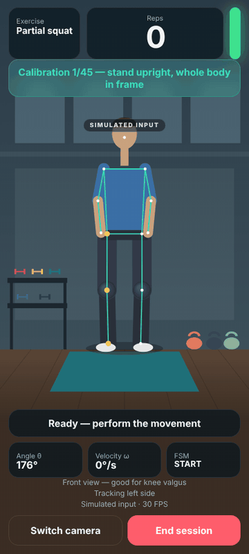
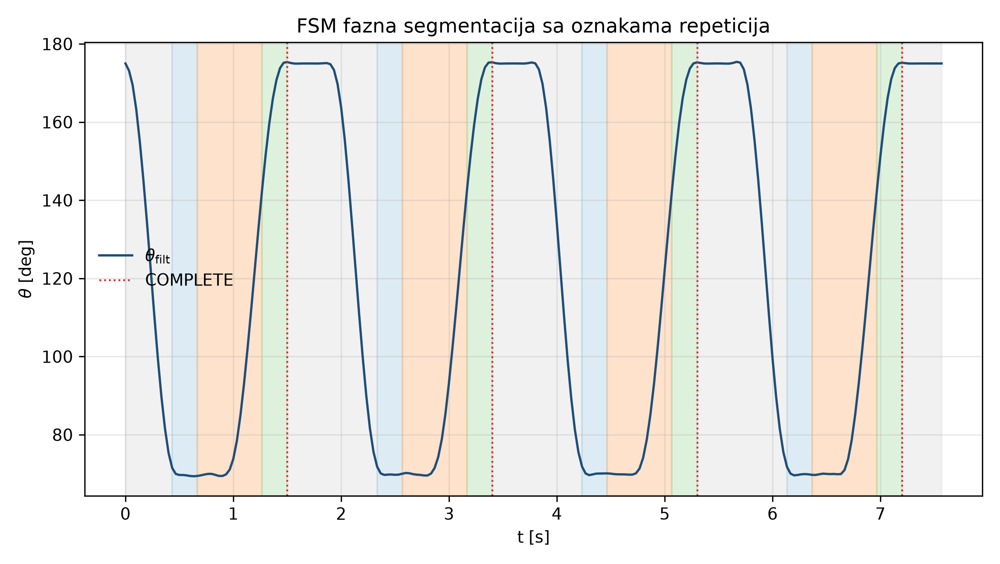
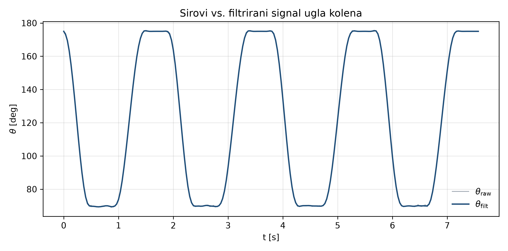
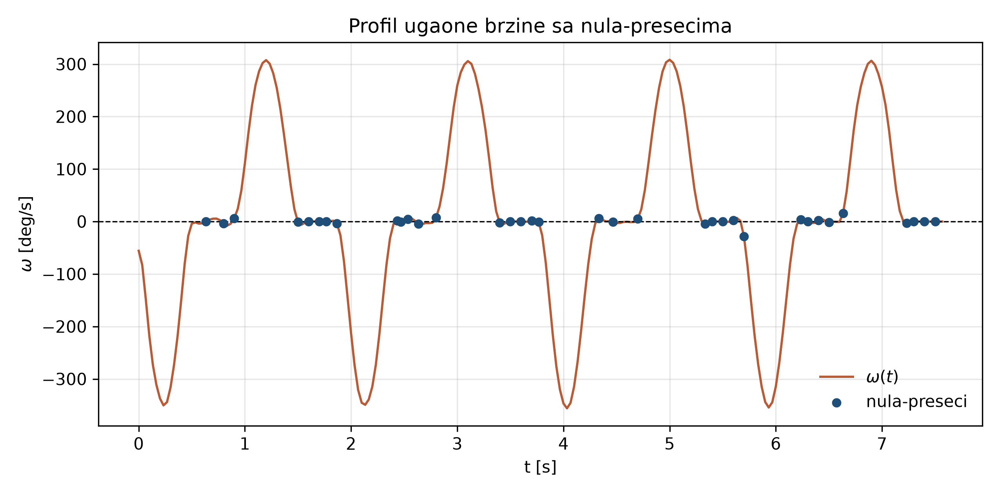

# AI Home Rehabilitation: Real-Time Pose Tracking

Real-time monitoring of rehabilitation exercises at home using only a camera.
The system estimates body pose, computes joint angles, filters the signal, counts repetitions with a finite state machine, and gives feedback on movement quality.

Seminar project · Master studies in Artificial Intelligence · Course: AI in Medicine
Author: Ajla Rašljanin

> 📄 The accompanying seminar paper, *Primena veštačke inteligencije u rehabilitaciji u kućnim uslovima* (Application of AI in home-based rehabilitation), is written in **Serbian** and is not included in this repository. Code comments are in Serbian; the mobile app UI is in English.

<p align="center">
  
  <br>
  <sub>Simulated pose input · real pipeline code (angles, Butterworth filter, FSM, quality checks)</sub>
</p>

## How it works

```
Camera ─► MediaPipe Pose ─► joint angles ─► Butterworth filter ─► angular velocity ─► FSM ─► rep count + quality feedback
          (33 landmarks)    (knee, shoulder,   (low-pass,          (ω)                 (START → DOWN → HOLD → UP → COMPLETE)
                             elbow)             causal / zero-phase)
```

1. **Pose estimation:** MediaPipe Pose returns 33 body landmarks with a visibility score per frame. Low-visibility frames are gated out and short gaps are interpolated.
2. **Joint angles:** knee (hip–knee–ankle), shoulder and elbow angles are computed from landmark vectors.
3. **Signal filtering:** a low-pass Butterworth filter removes jitter. A causal version runs in real time; a zero-phase version is used offline. Moving average is included as a baseline.
4. **Kinematics:** angular velocity from finite differences (central difference offline).
5. **Repetition counting:** a finite state machine (`START → DOWN → HOLD → UP → COMPLETE`) with hysteresis, a refractory period and majority voting over frames, so noise near thresholds does not cause double counts or bouncing.
6. **Movement quality:** each repetition is segmented and checked for insufficient range of motion, knee valgus and trunk lean.
7. **Calibration:** anthropometric normalization (estimated body height and thigh/shank lengths).
8. **Evaluation:** counting accuracy, quality confusion matrix and per-stage latency against the 30 FPS frame budget.

### Repetition counting



### Signal processing

| Raw vs. filtered knee angle | Angular velocity zero crossings |
|---|---|
|  |  |

## Mobile web app (PWA)

`mobile/` contains a browser-based version of the pipeline (MediaPipe Tasks Vision in JavaScript) that runs on a phone camera and can be installed as an app. It includes:

- three exercises: partial squat (early knee rehab, target ~110°), squat with a 70° target, and elbow flexion,
- live skeleton overlay, a rep counter and a traffic-light quality indicator,
- spoken cues (speech synthesis) and a per-repetition quality summary after each session.

`mobile/serve.py` starts a local server and, optionally, a Cloudflare quick tunnel, so the app can be opened on a phone over HTTPS (browsers only allow camera access over HTTPS or on localhost).

## Project structure

| Path | Description |
|------|-------------|
| `pose_pipeline/estimator.py` | MediaPipe Pose wrapper (33 landmarks) |
| `pose_pipeline/landmarks.py` | Joint angle computation and visibility gating |
| `pose_pipeline/interpolation.py` | Gap filling for low-visibility frames |
| `pose_pipeline/filtering.py` | Butterworth (causal and zero-phase) and moving average filters |
| `pose_pipeline/kinematics.py` | Angular and linear velocity |
| `pose_pipeline/fsm.py` | Finite state machine for repetition counting |
| `pose_pipeline/segmentation.py` | Repetition segmentation into sequences |
| `pose_pipeline/lstm_quality.py` | LSTM quality classifier architecture + heuristic fallback |
| `pose_pipeline/calibration.py` | Anthropometric calibration |
| `pose_pipeline/analyzer.py` | End-to-end processing (`MotionAnalyzer`) |
| `pose_pipeline/visualization.py` | Overlay and plots |
| `pose_pipeline/evaluation.py` | Accuracy and latency evaluation |
| `tests/test_pipeline.py` | Unit tests (26 tests) |
| `demo.py` | End-to-end demo on a synthetic squat signal (no camera needed) |
| `live.py` | Real-time demo with a webcam (OpenCV window) |
| `mobile/` | Mobile web app (PWA) |
| `docs/figures/` | Figures generated by `demo.py` |
| `docs/demo/` | Animated demo of the mobile app (simulated pose input) |

## Getting started

```bash
pip install -r requirements.txt

pytest tests/ -v          # unit tests
python demo.py            # synthetic demo, saves figures to output/thesis_figures/
python live.py            # webcam demo (needs mediapipe + opencv-python), ESC to quit
python mobile/serve.py    # mobile app at http://127.0.0.1:8765
```

`demo.py` simulates 4 squats; the FSM counts all 4. The synchronous processing part takes well under 1 ms per frame, far within the 33 ms budget at 30 FPS.

## Limitations

- **The LSTM quality classifier is not trained.** The architecture is implemented, but no labeled dataset of correct and incorrect repetitions was available, so movement quality is currently judged by a rule-based (heuristic) fallback using thresholds on range of motion, knee valgus and trunk lean.
- **Tests and the demo use synthetic signals.** The pipeline has not been evaluated on a labeled set of real recordings, so no real-world accuracy figures are reported.
- `mobile/serve.py` currently targets Windows (paths to `cloudflared.exe` and Git's `openssl.exe`).

## Disclaimer

This is an academic project. It is not a medical device and must not be used to replace guidance from a physiotherapist or doctor.
